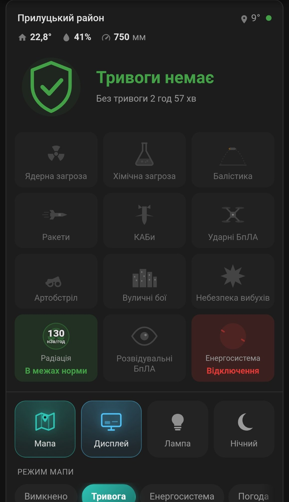
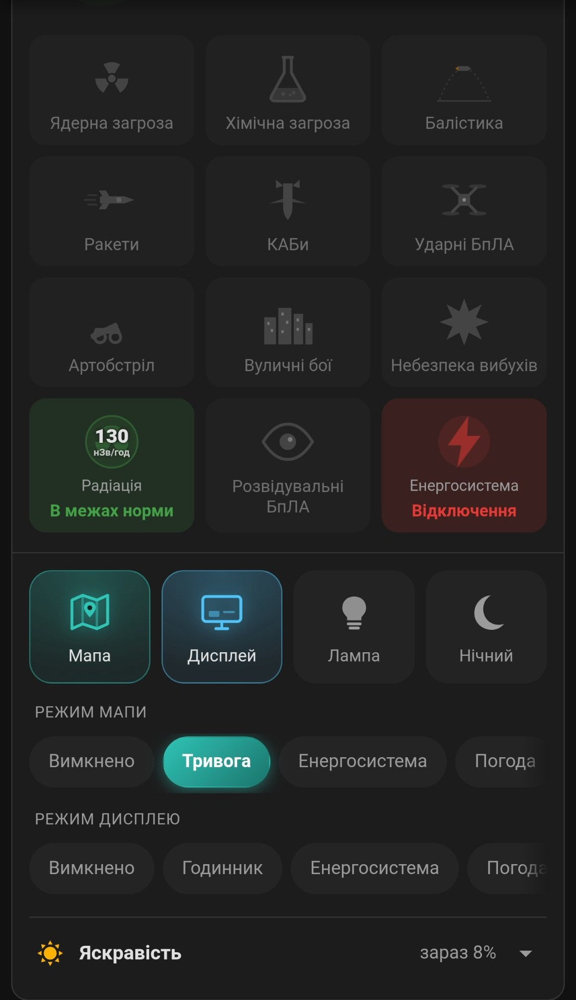

# JAAM Alert Card (Lovelace)

Картка для інтеграції `jaam_ha`. Показує стан тривоги в домашньому регіоні, рівень (жовтий або червоний), 10 типів загроз анімованими іконками, радіацію й стан енергосистеми регіону, клімат кімнати та керування мапою.

Сутності картка знаходить сама (через реєстр: платформа `jaam_ha` і `translation_key`), тому вказувати `entity_id` не потрібно.

## Як виглядає

<p>
  
  
</p>

Зліва верх картки: регіон, температура й клімат кімнати, рівень тривоги та тривалість. Нижче 10 плиток загроз (сірі, коли загрози немає), радіація й енергосистема регіону, кнопки керування й режими мапи. Справа те саме нижче, внизу згортний блок «Яскравість».

## Встановлення

1. Скопіюйте `jaam-alert-card-v1.5.js` у папку `/config/www/` вашого Home Assistant.
2. Увімкніть **Розширений режим** у профілі користувача.
3. Відкрийте **Налаштування → Панелі інструментів → ⋮ (три крапки) → Ресурси** і додайте ресурс:
   - URL: `/local/jaam-alert-card-v1.5.js`
   - Тип: **JavaScript module**
4. Очистіть кеш застосунку або браузера й оновіть сторінку.
5. Додайте картку на панель у YAML-режимі:

```yaml
type: custom:jaam-alert-card
```

## Параметри (усі необов'язкові)

| Параметр | Що робить |
|---|---|
| `title` | Свій заголовок замість назви району |
| `device_id` | Ідентифікатор пристрою, якщо мап кілька |
| `show_temp` | Температура в регіоні |
| `show_status` | Індикатор WebSocket-з'єднання |
| `show_controls` | Панель керування: мапа, дисплей, лампа, нічний режим, режими мапи й дисплея |
| `show_climate` | Рядок клімату кімнати з датчика мапи (температура, вологість, тиск) |
| `tile_hold_minutes` | Скільки хвилин плитка загрози лишається активною після спрацювання сенсора (за замовчуванням 20). На плитці йде таймер «скільки минуло» (мм:сс) |
| `show_brightness` | Згортний блок «Яскравість» (повзунки й перемикачі) |

Керування: тап перемикає, довге натискання відкриває вікно сутності.

## Що показують плитки загроз

Плитка загоряється, коли вмикається відповідний датчик `home_alert_*` (ракети, балістика, КАБи, БпЛА та інші). Сірі плитки означають, що цього типу загрози в стані тривоги немає. Верхній блок показує рівень (червоний, жовтий або «тривоги немає») і скільки він триває.

Радіація й енергосистема це окремі плитки зі значеннями. Пороги радіації як у прошивці: 300, 600 і 1000 нЗв/год.

## Обмеження

- Короткі повідомлення про тип загрози, які мапа показує на своєму екрані на кілька секунд (наприклад, «БпЛА»), прошивка не передає до Home Assistant, тому плитки на них не реагують. Плитки відображають стан тривоги.
- Блок «Яскравість», плитки радіації й енергосистеми, а також рядок клімату з'являються лише тоді, коли прошивка й інтеграція передають відповідні дані. Блок яскравості потребує прошивки з об'єктом `brightness` та відповідних сутностей інтеграції.

## Що нового у v1.5
- Плитки загроз (дрони, ракети, КАБ тощо) після спрацювання сенсора лишаються активними 20 хвилин (`tile_hold_minutes`). На плитці видно таймер, скільки минуло від спрацювання: `00:00` → `20:00`, далі плитка гасне.
- Час спрацювання береться з історії Home Assistant, тому таймер не збивається після перезавантаження сторінки чи на іншому пристрої.
- Головний статус картки (тривога/загроза) не змінюється: він як і раніше показує поточний стан сенсорів.
- Якщо Home Assistant був вимкнений або не мав зв'язку з мапою в момент спрацювання, цього спрацювання в історії не буде.

Після заміни файлу в `/config/www/` змініть у ресурсах Lovelace адресу на `/local/jaam-alert-card-v1.5.js` (або додайте `?v=1.5` для скидання кешу) і оновіть сторінку.
